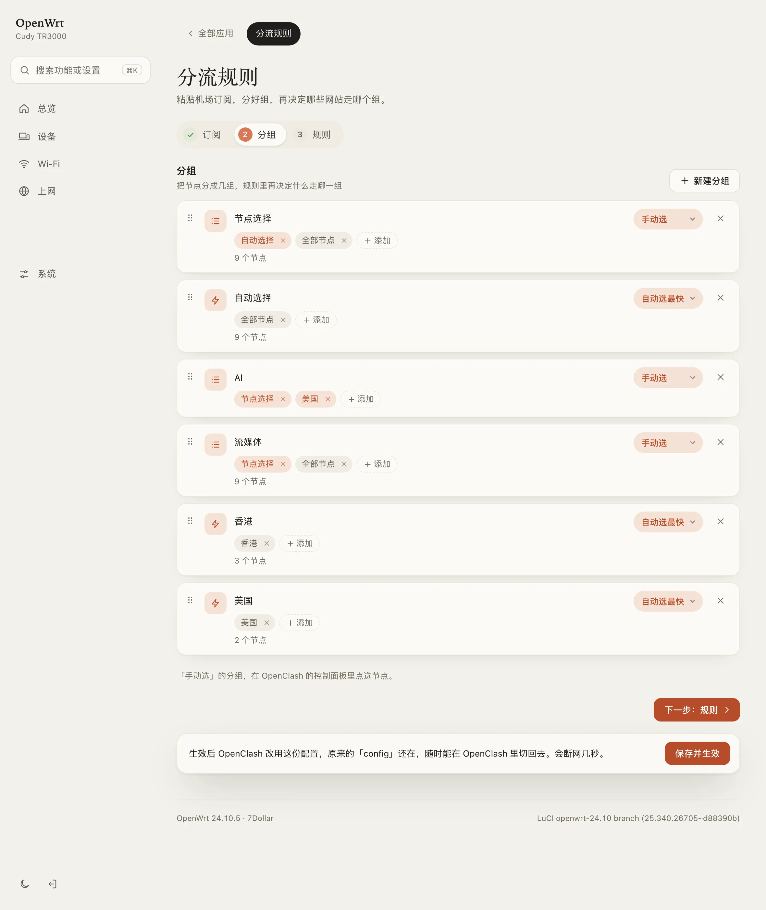
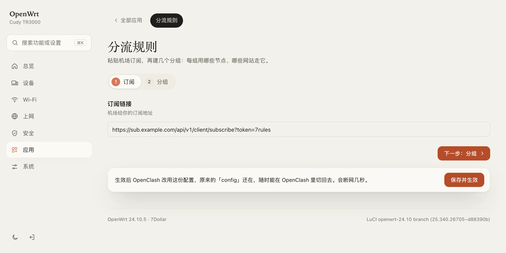
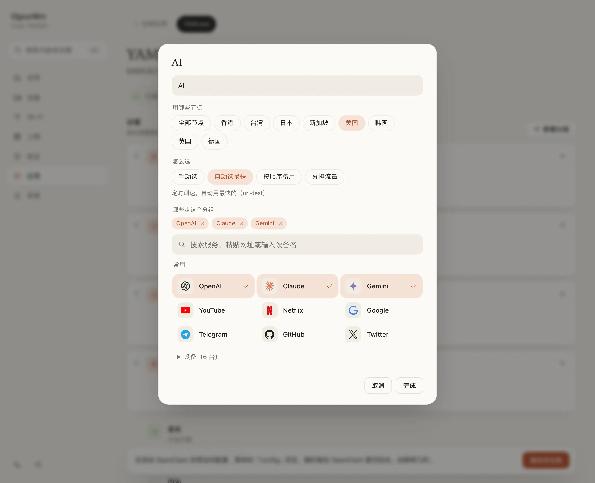

<h1 align="center">7Rules · 分流规则</h1>

<p align="center">
  只有一个机场订阅链接，也能点几下配好 OpenClash 分流<br>
  <sub>From one subscription link to working OpenClash split rules, without writing YAML</sub>
</p>

<p align="center">
  
  
  
</p>

<p align="center">
  <a href="#安装">安装</a> · <a href="#使用">使用</a> · <a href="#常见问题">常见问题</a> · <a href="#english">English</a>
</p>

<p align="center">
  
</p>

## 为什么做它

机场一般只给一个订阅链接。想让 ChatGPT 走美国节点、YouTube 走香港节点、国内网站直连，原本得自己写配置文件：`proxy-providers`、`proxy-groups`、`rule-providers`、`rules` 四段，写错一个缩进就启动失败。

7Rules 只有两步，全程点选：

| 步骤 | 做什么 |
| --- | --- |
| **1 订阅** | 粘贴链接。填好才能进下一步 |
| **2 分组** | 默认已有「国外」（全部节点）和「直连」（局域网、国内）。想单独分流就新建一个组（比如「AI」），上面选用哪些节点，下面搜「ChatGPT」「Claude」放进来 |

点 **保存并生效**，它会生成一份完整的 OpenClash 配置，先让内核检查一遍，没问题才切换过去。

## 特性

- **一个组一张卡**：用哪些节点、哪些网站走它，在同一个地方选好。拖动卡片调整优先级
- **只预设人人都要的**：局域网和国内网站直连，其余走「国外」（全部节点，自动选最快）。只填订阅就能用；新建分组时可一键填好常用组合（AI、流媒体、社交……）
- **按地区选节点**：香港、日本、美国……按节点名自动筛选，不用逐个挑；机场塞进节点列表的「剩余流量」「到期时间」会被过滤掉
- **搜索即用**：常用平台带图标；内置 [blackmatrix7/ios_rule_script](https://github.com/blackmatrix7/ios_rule_script) 的 660+ 个规则集，支持中文搜索
- **网址和设备**：粘贴网址自动提取域名；从在线设备里点选，让某台设备全部直连或走代理
- **不会改坏**：生效前由内核检查配置，没通过就不切换；原来的配置留在 OpenClash 里，随时切回
- **轻**：安装包 29 KB，只是一个网页，没有后台进程。只有点「保存并生效」时路由器才干活
- **兼容**：OpenClash 的 Meta（mihomo）内核；任何 LuCI 主题下都能用，配合 [7Dollar](https://github.com/itsmaiGe/luci-theme-7dollar) 主题效果最好

<p align="center">
  
  
</p>

## 安装

需要先装好 **OpenClash**，路由器系统是 **OpenWrt 23.05 或更新版本**。

### 方法一：网页上传（推荐）

适用于 23.05 / 24.10。

1. 下载安装包：[luci-app-7rules_0.3.0-r1_all.ipk](https://github.com/itsmaiGe/luci-app-7rules/releases/latest/download/luci-app-7rules_0.3.0-r1_all.ipk)
2. 浏览器打开路由器后台（通常是 `192.168.1.1`），登录
3. 点 **系统 → 软件包 → 上传软件包…**，选择刚下载的文件，点 **上传**，再点 **安装**
4. 刷新页面，在 **服务 → 分流规则** 里打开（7Dollar 主题在「应用」里）

### 方法二：命令行

SSH 登录路由器（`ssh root@192.168.1.1`）后粘贴：

```sh
# OpenWrt 23.05 / 24.10
cd /tmp && wget -O 7rules.ipk https://github.com/itsmaiGe/luci-app-7rules/releases/latest/download/luci-app-7rules_0.3.0-r1_all.ipk && opkg install 7rules.ipk

# OpenWrt 25.x
cd /tmp && wget -O 7rules.apk https://github.com/itsmaiGe/luci-app-7rules/releases/latest/download/luci-app-7rules-0.3.0-r1.apk && apk add --allow-untrusted 7rules.apk
```

路由器连不上 GitHub 时，用方法一：先在电脑上下载，再上传。

## 使用

1. **订阅**：粘贴机场给的订阅链接，点 **下一步**
2. **分组**：默认的「国外」和「直连」已经够用。想单独分流，点 **新建分组**，起个名字，选用哪些节点，再搜索要走这个组的服务、网址或设备
3. 底部 **其他所有** 默认走「国外」，没对上任何规则的流量走它
4. 点 **保存并生效**。OpenClash 会重启，断网几秒

「手动选」的分组，在 OpenClash 的控制面板里点选节点。

## 常见问题

<details>
<summary><b>生效后没有节点</b></summary>

<br>

订阅由 OpenClash 自己下载。检查链接是否完整；有的机场要求在后台把订阅格式选成 Clash。如果某个组选了「日本」，但订阅里没有名字带「日本 / JP / Tokyo」的节点，这个组会是空的，改选别的地区或「全部节点」。
</details>

<details>
<summary><b>想换回原来的配置</b></summary>

<br>

打开 OpenClash → **配置文件管理**，选回原来的配置，启动即可。7Rules 生成的配置叫 `7rules.yaml`，留在那里不影响。
</details>

<details>
<summary><b>规则集下载失败</b></summary>

<br>

在「分组」这一步底部打开 **更多 → 规则集下载地址**，换一个地址后保存。
</details>

<details>
<summary><b>设备提示「建议设为静态」</b></summary>

<br>

设备规则按 IP 匹配。去 **网络 → DHCP**（7Dollar 主题在「设备」里）给它设一个静态地址，规则才会一直有效。
</details>

<details>
<summary><b>从源码编译</b></summary>

<br>

在 OpenWrt 源码或 SDK 中：

```sh
git clone https://github.com/itsmaiGe/luci-app-7rules.git package/luci-app-7rules
make package/luci-app-7rules/compile V=s
```

不用 SDK 时，在 macOS / Linux 上运行 `./scripts/build-ipk.sh`（需要 Node.js）。规则集列表每月由 GitHub Actions 从 blackmatrix7 更新（`scripts/gen-sets.mjs`），中文搜索词在 `scripts/aliases.txt`，欢迎补充。
</details>

## 兼容性

| | |
| --- | --- |
| OpenWrt | 23.05、24.10（ipk），25.x（apk） |
| OpenClash | Meta（mihomo）内核 |
| 订阅格式 | 内核能读的都行：Clash / mihomo 订阅，或常见的分享链接订阅 |
| 浏览器 | 2023 年以后的 Chrome / Edge / Safari / Firefox |
| 已测试 | Cudy TR3000 · OpenWrt 24.10.5 · OpenClash 0.48 · mihomo 1.19 |

## 致谢

- [blackmatrix7/ios_rule_script](https://github.com/blackmatrix7/ios_rule_script)：规则集来源
- [Simple Icons](https://simpleicons.org)：平台图标（CC0，商标归各自所有者）
- [OpenClash](https://github.com/vernesong/OpenClash)

## English

7Rules is a LuCI page for OpenClash that takes you from a single subscription link to a working config in two steps: paste the link, then make groups. Each group card holds which nodes it uses (all or by region; pick / fastest / failover) and what goes through it (660+ rule sets from blackmatrix7/ios_rule_script, URLs or devices). Drag cards to set priority; by default the local network and China go direct and everything else uses an "Overseas" group with all nodes. Applying writes one complete config, has the core check it, then switches OpenClash to it; your old config stays. 29 KB, no background process.

Install: download the ipk (OpenWrt 23.05 / 24.10) or apk (25.x) from [Releases](https://github.com/itsmaiGe/luci-app-7rules/releases) and upload it under **System → Software**. The page is at **Services → 分流规则**.

## License

[Apache-2.0](LICENSE)
