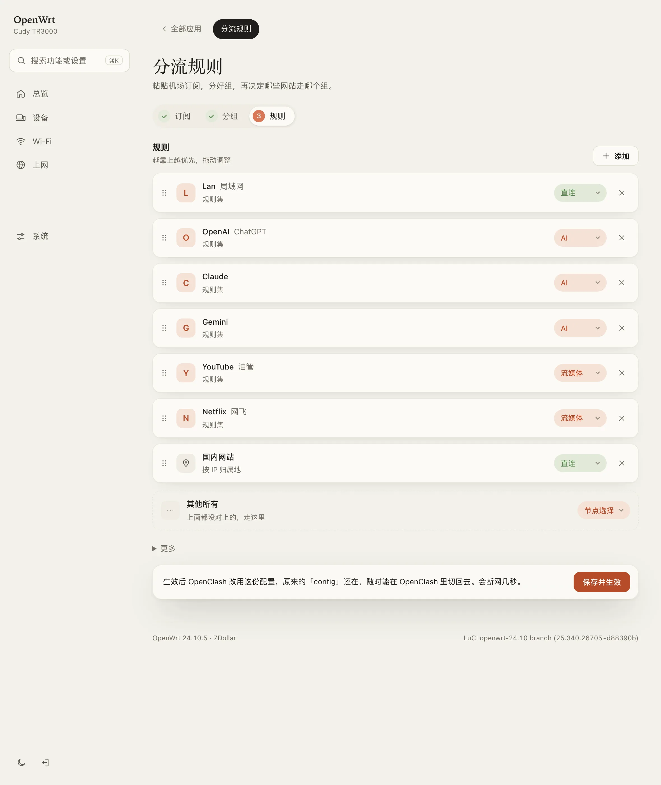

<h1 align="center">7Rules · 分流规则</h1>

<p align="center">
  不用写 YAML 的 OpenClash 分流规则<br>
  <sub>Split rules for OpenClash, without writing YAML</sub>
</p>

<p align="center">
  
  
  
</p>

<p align="center">
  <a href="#安装">安装</a> · <a href="#使用">使用</a> · <a href="#常见问题">常见问题</a> · <a href="#english">English</a>
</p>

<p align="center">
  
</p>

## 为什么做它

想让 YouTube 走代理、让某台电脑全部直连，原本要打开配置文件，照着格式写 `RULE-SET`、`rule-providers`，写错一个缩进就启动失败。

| | 手写配置 | 7Rules |
| --- | --- | --- |
| 添加规则 | 查规则集地址，写 rule-providers 和 rules 两段 | 搜「油管」，点一下，选走哪里 |
| 调整优先级 | 剪切粘贴行 | 拖动卡片 |
| 选设备 | 查 IP，写 `SRC-IP-CIDR` | 从在线设备里点选 |
| 写错了 | OpenClash 启动失败或规则被跳过 | 不存在的策略组直接标红 |
| 更新订阅 | 改过的配置可能被覆盖 | 不碰订阅，规则单独保存 |

## 特性

- **搜索即用**：内置 [blackmatrix7/ios_rule_script](https://github.com/blackmatrix7/ios_rule_script) 的 660+ 个规则集，支持中文搜索（油管、网飞、哔哩哔哩、电报……）
- **粘贴网址**：直接粘贴链接，自动提取域名
- **选设备**：列出在线设备，点选即可让它全部直连或走代理
- **拖动排序**：越靠上越优先，手机上也能拖
- **不碰订阅**：只写 OpenClash 的「自定义规则」文件，订阅更新不影响
- **原样保留**：文件里原有的手写内容不会丢；第一次保存前自动备份
- **轻**：安装包 19 KB，只是一个网页，没有后台进程，不占路由器资源
- **兼容**：Meta（mihomo）和 Premium 内核都可以用；任何 LuCI 主题下都能正常显示，配合 [7Dollar](https://github.com/itsmaiGe/luci-theme-7dollar) 主题效果最好

## 安装

需要先装好 **OpenClash**，路由器系统是 **OpenWrt 23.05 或更新版本**。

### 方法一：网页上传（推荐）

适用于 23.05 / 24.10。

1. 下载安装包：[luci-app-7rules_0.1.0-r1_all.ipk](https://github.com/itsmaiGe/luci-app-7rules/releases/latest/download/luci-app-7rules_0.1.0-r1_all.ipk)
2. 浏览器打开路由器后台（通常是 `192.168.1.1`），登录
3. 点 **系统 → 软件包 → 上传软件包…**，选择刚下载的文件，点 **上传**，再点 **安装**
4. 刷新页面，在 **服务 → 分流规则** 里打开（7Dollar 主题在「应用」里）

### 方法二：命令行

SSH 登录路由器（`ssh root@192.168.1.1`）后粘贴：

```sh
# OpenWrt 23.05 / 24.10
cd /tmp && wget -O 7rules.ipk https://github.com/itsmaiGe/luci-app-7rules/releases/latest/download/luci-app-7rules_0.1.0-r1_all.ipk && opkg install 7rules.ipk

# OpenWrt 25.x
cd /tmp && wget -O 7rules.apk https://github.com/itsmaiGe/luci-app-7rules/releases/latest/download/luci-app-7rules-0.1.0-r1.apk && apk add --allow-untrusted 7rules.apk
```

路由器连不上 GitHub 时，用方法一：先在电脑上下载，再上传。

## 使用

1. 点 **添加**，搜索服务名（中英文都行）、粘贴网址，或者选一台设备
2. 选它走哪里：**直连**、**拦截**，或你订阅里的某个策略组
3. 拖动卡片调整先后，点 **保存并生效**

保存时 OpenClash 会重启，断网几秒。规则写在 `/etc/openclash/custom/openclash_custom_rules.list`，排在订阅规则前面。

## 常见问题

<details>
<summary><b>规则卡片标红「策略组不存在」</b></summary>

<br>

订阅里没有这个策略组（可能换了订阅或改了名字），OpenClash 会跳过这条规则。点卡片右边重新选一个。
</details>

<details>
<summary><b>规则集下载失败</b></summary>

<br>

打开页面底部 **更多 → 规则集下载地址**，换一个地址后保存。
</details>

<details>
<summary><b>设备卡片显示「IP 会变」</b></summary>

<br>

设备规则按 IP 匹配。去 **网络 → DHCP**（7Dollar 主题在「设备」里）给它设一个静态地址，规则才会一直有效。
</details>

<details>
<summary><b>卸载后规则还在吗</b></summary>

<br>

在。卸载只删除这个页面，规则文件留给 OpenClash 继续使用。不想要的话，在 OpenClash 的「覆写设置 → 规则设置」里关掉自定义规则即可。第一次保存前的原文件备份在 `openclash_custom_rules.list.bak`。
</details>

<details>
<summary><b>从源码编译</b></summary>

<br>

在 OpenWrt 源码或 SDK 中：

```sh
git clone https://github.com/itsmaiGe/luci-app-7rules.git package/luci-app-7rules
make package/luci-app-7rules/compile V=s
```

不用 SDK 时，在 macOS / Linux 上运行 `./scripts/build-ipk.sh`（需要 Node.js）。规则集列表每月由 GitHub Actions 从 blackmatrix7 更新（`scripts/gen-sets.mjs`），中文搜索词在 `scripts/aliases.txt`，欢迎补充。
</details>

## 兼容性

| | |
| --- | --- |
| OpenWrt | 23.05、24.10（ipk），25.x（apk） |
| OpenClash 内核 | Meta（mihomo）、Premium；Dev 内核不支持规则集 |
| 浏览器 | 2023 年以后的 Chrome / Edge / Safari / Firefox |
| 已测试 | Cudy TR3000 · OpenWrt 24.10.5 · OpenClash 0.48 · mihomo |

## 致谢

- [blackmatrix7/ios_rule_script](https://github.com/blackmatrix7/ios_rule_script)：规则集来源
- [OpenClash](https://github.com/vernesong/OpenClash)

## English

7Rules is a LuCI page for OpenClash: search a service (660+ rule sets from blackmatrix7/ios_rule_script), paste a URL or pick a device, choose Direct / Block / one of your proxy groups, and drag to reorder. It only writes OpenClash's custom rules file, so subscription updates never overwrite your rules. 19 KB, no background process.

Install: download the ipk (OpenWrt 23.05 / 24.10) or apk (25.x) from [Releases](https://github.com/itsmaiGe/luci-app-7rules/releases) and upload it under **System → Software**. The page is at **Services → 分流规则**.

## License

[Apache-2.0](LICENSE)
